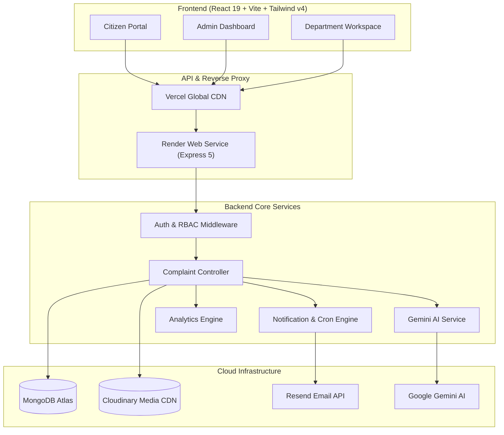

# 🏛️ Smart Complaint Management System (SCMS)

> An intelligent, AI-augmented municipal and organizational grievance redressal platform engineered to streamline public complaint logging, automate department routing, accelerate issue resolution, and provide end-to-end transparency.

---

## 🌐 Live Production Deployments

| Component | Platform | Live URL |
|---|---|---|
| **Frontend Web App** | **Vercel** | [https://smart-complaint-management-system-kappa.vercel.app](https://smart-complaint-management-system-kappa.vercel.app) |
| **Backend API Service** | **Render** | [https://scms-backend-t4wx.onrender.com](https://scms-backend-t4wx.onrender.com) |
| **Database** | **MongoDB Atlas** | Cloud Replica Set (AWS Mumbai) |
| **Media Storage** | **Cloudinary** | Cloud Image CDN |
| **Email Delivery** | **Resend** | HTTPS API (`onboarding@resend.dev`) |

---

## 📑 Table of Contents
1. [System Architecture](#-system-architecture)
2. [Key Highlights & Differentiators](#-key-highlights--differentiators)
3. [User Roles & Permissions (RBAC)](#-user-roles--permissions-rbac)
4. [Complete Feature Breakdown](#-complete-feature-breakdown)
   - [AI Engine (Google Gemini)](#1-ai-powered-triaging--intelligence)
   - [Complaint Lifecycle & Workflow](#2-complaint-lifecycle--timeline-tracking)
   - [Dashboards & Analytics](#3-dashboards--data-visualization)
   - [Reporting & Exports](#4-reporting--export-engine)
   - [Notification Engine](#5-omnichannel-notification-system)
   - [Security & Access Control](#6-enterprise-grade-security--hardening)
5. [Technology Stack](#-technology-stack)
6. [API Architecture](#-api-architecture)
7. [Getting Started (Local Development)](#-getting-started-local-development)
8. [Environment Configuration](#-environment-configuration)

---

## 🏗️ System Architecture



---

## ✨ Key Highlights & Differentiators

* 🤖 **AI-Assisted Classification:** Google Gemini automatically parses raw complaints, assigns the appropriate municipal department, estimates priority, and detects urgency/sentiment.
* 📸 **Visual Proof of Resolution:** Field officers upload mandatory timestamped resolution evidence images before a complaint can be resolved.
* ⏱️ **Audited Lifecycle Timeline:** Every status change, assignment, note, or escalation generates an immutable timeline entry visible to users and administrators.
* 📊 **Executive Analytics & Reporting:** Interactive charts powered by Recharts, with one-click export to official branded PDF reports and Excel spreadsheets.
* 📬 **Reliable Notification Architecture:** Dual-channel delivery (in-app notification center + email notifications) with a self-healing background retry worker (`RetryJob`).

---

## 👥 User Roles & Permissions (RBAC)

The system enforces strict role-based access control across 4 distinct personas:

| Role | Primary Responsibilities | Portal Access |
|---|---|---|
| **Citizen / User** | • File complaints with photos & locations<br>• Track live status & timeline<br>• Rate & provide feedback on resolved complaints | `/dashboard`, `/my-complaints`, `/complaints/new` |
| **Department Member (Field Officer)** | • Review assigned tickets<br>• Add field notes & update status<br>• Upload before/after proof images for resolution | `/member/dashboard`, `/member/workload` |
| **Department Head** | • Supervise department workload<br>• Assign complaints to specific field officers<br>• Reassign or transfer complaints across departments | `/admin/departments`, `/member` |
| **System Admin** | • Full system governance<br>• Department & user management<br>• View global municipal analytics & generate reports | `/admin/dashboard`, `/admin/analytics`, `/admin/users` |

---

## 🚀 Complete Feature Breakdown

### 1. AI-Powered Triaging & Intelligence
* **Auto-Categorization:** Uses Google Gemini 2.0 to categorize complaints into appropriate departments (Water Supply, Waste Management, Electricity, Roads & Infrastructure, Health & Sanitation, etc.).
* **Priority Detection:** Evaluates civic risk and flags tickets as `Low`, `Medium`, `High`, or `Critical`.
* **Title & Description Clean-Up:** Restructures unstructured citizen input into concise, actionable summaries for field teams.

### 2. Complaint Lifecycle & Timeline Tracking
* **Multi-Image Upload:** Direct Cloudinary media integration with automated client-side WebP compression.
* **Granular Workflow States:**
  ```text
  [Pending] ➔ [In Review] ➔ [Assigned] ➔ [In Progress] ➔ [Resolved] ➔ [Closed]
                                       ↘ [Rejected]
  ```
* **Visual Audit Timeline:** Real-time event log recording exact timestamps, user names, role designations, status transitions, and administrative remarks.
* **Proof of Work Enforcement:** Prevents marking tickets as `Resolved` without verifiable photographic evidence.

### 3. Dashboards & Data Visualization
* **Citizen View:** Total submitted, pending count, resolved ratio, and active tickets list.
* **Admin & Officer Dashboard:**
  - Status distribution donut charts
  - Monthly complaint trends & seasonal spike detection
  - Department performance benchmarks (Average Resolution Time in hours/days)
  - Member workload balance gauges

### 4. Reporting & Export Engine
* **PDF Document Generation:** Client-side vector PDF generation using `jspdf` and `jspdf-autotable` with corporate header, metadata summary, and tabulated data.
* **Excel Data Export:** One-click `.xlsx` export using SheetJS for municipal audits and spreadsheet processing.
* **Custom Date Filtering:** Filter reports by `Today`, `Last 7 Days`, `This Month`, `Year to Date`, or custom date intervals.

### 5. Omnichannel Notification System
* **In-App Notification Center:** Real-time badge counter, category filtering, and "mark all as read" capability.
* **Transactional Emails:** Triggered on complaint submission, status change, officer assignment, and final resolution.
* **Automated Cron Jobs:**
  - `Daily Summary Job` — Dispatches morning summaries at 08:00 AM.
  - `Weekly Analytics Job` — Dispatches weekly digests every Monday at 09:00 AM.
  - `Retry Job` — Background worker executing every 5 minutes to automatically retry failed email deliveries.
* **Multi-Provider Architecture:** Pluggable factory supporting `Resend`, `SMTP (Gmail)`, `SendGrid`, `AWS SES`, and `Console` logging.

### 6. Enterprise-Grade Security & Hardening
* **Dual Authentication:** Google OAuth 2.0 Sign-In + Traditional JWT & Bcrypt credentials.
* **Strict CORS & Header Protection:** Dynamic origin whitelisting with `Helmet` security headers.
* **Zod Schema Validation:** Comprehensive runtime schema validation on all API requests.
* **Rate Limiting:** Express rate limiters applied on authentication and file upload routes to mitigate brute force and DoS attacks.
* **Data Isolation:** Department-level isolation preventing members from modifying or reading tickets outside their jurisdiction.

---

## 💻 Technology Stack

### Frontend
* **Core:** React 19, Vite 8, React Router v7
* **Styling:** Tailwind CSS v4, Lucide React, React Icons
* **Charts & Visuals:** Recharts
* **Document Generation:** jsPDF, jspdf-autotable, html2canvas, html-to-image, xlsx
* **Notifications:** React Hot Toast
* **Auth:** `@react-oauth/google`

### Backend
* **Runtime & Framework:** Node.js, Express 5
* **Database & ODM:** MongoDB Atlas, Mongoose 9
* **AI Integration:** Google Gen AI SDK (`@google/genai`)
* **File Uploads:** Multer, Cloudinary v2, Streamifier, Browser-Image-Compression
* **Scheduling:** node-cron
* **Email Providers:** Resend API, Nodemailer
* **Validation & Security:** Zod, Helmet, Bcryptjs, JsonWebToken, Express Rate Limit
* **Logging:** Winston Logger

---

## 🔌 API Architecture

All endpoints follow RESTful standards and return standardized JSON responses:
```json
{
  "success": true,
  "data": { ... },
  "message": "Operation successful"
}
```

### Core API Endpoints:

| Category | Method | Endpoint | Description |
|---|---|---|---|
| **Auth** | `POST` | `/api/auth/register` | Register new citizen user |
| | `POST` | `/api/auth/login` | Email & password login |
| | `POST` | `/api/auth/google` | Google OAuth token verification |
| | `POST` | `/api/auth/forgot-password` | Generate reset token & send email |
| **Complaints** | `GET` | `/api/complaints/my` | Retrieve logged-in user complaints |
| | `POST` | `/api/complaints` | Create complaint with media & AI classification |
| | `GET` | `/api/complaints/:id` | Fetch complaint details & timeline |
| | `PATCH` | `/api/complaints/:id/status` | Update complaint status & add remarks |
| | `POST` | `/api/complaints/:id/proof` | Upload resolution proof images |
| **Admin** | `GET` | `/api/admin/dashboard` | Overall system metrics & analytics |
| | `GET` | `/api/admin/users` | List all users with role filtering |
| | `PATCH` | `/api/admin/users/:id/status` | Activate or deactivate accounts |
| **Departments** | `GET` | `/api/departments` | List all active departments |
| | `POST` | `/api/departments/:id/members`| Onboard department member |
| **Notifications** | `GET` | `/api/notifications` | Get user notifications list |
| | `PATCH` | `/api/notifications/:id/read` | Mark notification as read |

---

## 🛠️ Getting Started (Local Development)

### 1. Prerequisites
- Node.js (v18 or higher)
- MongoDB instance (Local or Atlas)
- Git

### 2. Clone Repository
```bash
git clone https://github.com/gaurav27-kit/smart-complaint-management-system.git
cd smart-complaint-management-system
```

### 3. Install Dependencies
```bash
# Root concurrent runner
npm install

# Backend dependencies
cd backend && npm install

# Frontend dependencies
cd ../frontend && npm install
cd ..
```

### 4. Setup Environment Files
Create `backend/.env` based on `backend/.env.example`:
```env
PORT=5000
NODE_ENV=development
MONGO_URI=mongodb://127.0.0.1:27017/scms
JWT_SECRET=your_jwt_secret
CLOUDINARY_CLOUD_NAME=your_name
CLOUDINARY_API_KEY=your_key
CLOUDINARY_API_SECRET=your_secret
GEMINI_API_KEY=your_gemini_key
EMAIL_PROVIDER=console
```

Create `frontend/.env` based on `frontend/.env.example`:
```env
VITE_API_URL=http://localhost:5173/api
VITE_GOOGLE_CLIENT_ID=your_google_client_id.apps.googleusercontent.com
```

### 5. Launch Application
Run both frontend and backend concurrently from the root:
```bash
npm run dev
```

- **Frontend:** [http://localhost:5173](http://localhost:5173)
- **Backend API:** [http://localhost:5000](http://localhost:5000)

---

## 📄 License & Credits
Developed as part of the **Smart Complaint Management System (SCMS)** initiative.  
Licensed under the **ISC License**.
